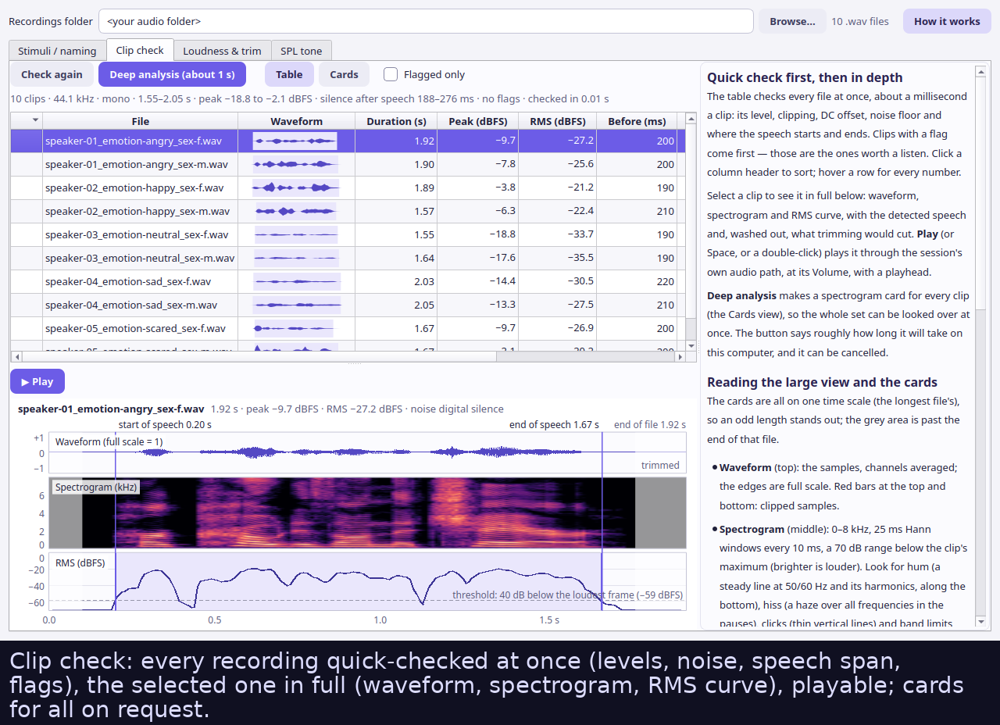

# Emognition 3

**Speech Emotion Recognition** — a behavioral experiment platform in which a participant
hears a short speech clip and identifies the conveyed emotion (happy, scared,
neutral, sad, or angry). Responses and millisecond-accurate reaction times are
recorded and exported as Excel, PDF, HTML, and CSV reports.

A Python / PsychoPy rewrite of the original MATLAB *Emognition 2* (Auditory
Prostheses & Perception Lab, Boys Town National Research Hospital, 2014–2020),
with feature parity plus a modern UX and cross-platform support. The software
was built for Dr. Monita Chatterjee's
[APPLab](https://sites.northwestern.edu/monitachatterjee/) (now at Northwestern
University) to support research on emotional prosody in cochlear-implant users.
Original MATLAB sources are preserved under [`matlab/`](matlab/) as reference
and homage.

---

## Screenshots

| Experimenter setup | Experiment screen | Live monitor |
|:---:|:---:|:---:|
|  |  |  |
| Configure participant, audio folder, mode, and emotions before each session. | Participant hears a clip, then clicks the perceived emotion. Buttons activate after the clip ends. | Accuracy and reaction time update trial-by-trial on the experimenter's screen. |

<details>
<summary><strong>Calibration window (4 tabs)</strong></summary>

| Stimuli / naming | Clip check |
|:---:|:---:|
|  |  |
| **Loudness & trim** | **SPL tone** |
|  |  |

</details>

---

## Features

| Feature | Details |
|---|---|
| **Millisecond-accurate RTs** | PTB-scheduled audio onset; RT measured from both offset (default, matching legacy) and onset |
| **Test mode** | Blind test — no feedback — full confusion-matrix report |
| **Familiarization** | The participant just listens and watches: each clip's correct face is revealed after it (the original's passive training) |
| **Practice** | The participant responds, then gets correct (green) / wrong (orange) feedback before advancing; optionally *retry until correct*, as in the original (its active training) |
| **Emoticon buttons** | Crisp at any screen size (drawn at 512 px from the original artwork); captions in English, Spanish or Traditional Chinese, or none, set in Noto Sans |
| **Begin screen** | The participant starts the session with a big **Begin** button (or Space/Enter); the report's start time and duration count from that press |
| **Background pictures** | Calm, text-free backgrounds to keep participants engaged: a soothing gradient by default, 30 bundled scenes, your own pictures via **Add picture…**, or a slideshow that changes every N trials |
| **Balanced order** | A shuffle with at most N of one emotion in a row, reproducible from the recorded seed |
| **Replays** | Off by default; when allowed, a limit per trial that starts at the number of emotions tested (1–10, or no limit) |
| **Participant IDs** | BIDS-style `sub-001`, filled in with the next free number; an ID that already has reports can be amended, reused or edited |
| **Engagement and pacing** | Opt-in: a *Next* button between trials (the original's Extra button), a star every N trials, a break screen every N trials. None of it depends on whether answers are right |
| **Pause and safe quit** | **P** pauses and resumes; **Esc** asks before quitting. A trial interrupted either way is replayed, and the per-trial CSV counts it |
| **Crash-safe autosave** | Every trial is on disk the moment it ends; an interrupted session resumes at the next trial, in the same order |
| **Calibration** | Check a stimulus set at a glance (waveform, spectrogram and RMS curve of every clip, flags for clipping, DC offset, noise, cut-off speech); equalise loudness (ITU-R BS.1770) and trim silence, with before/after charts; BIDS-style renaming; an SPL tone at the session volume. Every step is explained in the window |
| **Experimenter monitor** | Live per-trial accuracy and RT on the experimenter's screen while the participant runs |
| **Reports** | Self-contained HTML, PDF (confusion heatmap + RT charts), Excel (4 sheets), CSV |
| **Multi-display** | Experiment auto-routes to the participant's screen; setup stays on the experimenter's |
| **Stimulus flexibility** | Legacy `01_ang_f.wav` and BIDS-style `speaker-01_emotion-angry_sex-f.wav` both accepted |
| **Open source** | AGPL-3.0-or-later; no MATLAB, no proprietary toolboxes |

---

## Installation

**Linux — quick start (pre-built)**

```bash
# Download emognition-linux-x86_64.zip from the Releases page, then:
unzip emognition-linux-x86_64.zip
chmod +x emognition/emognition
./emognition/emognition
```

<details>
<summary><strong>Windows — pre-built (no Python needed)</strong></summary>

**No Python, no installation program — just unzip and run.**

1. Go to the [**Releases page**](https://github.com/mhozan/Emognition/releases)
   and click the latest release (top of the list).

2. Under **Assets**, click **`emognition-windows-x86_64.zip`** to download it.

3. **Extract the zip:**
   - Find the downloaded file (usually in your `Downloads` folder).
   - Right-click it → **Extract All…**
   - Choose where to put it — e.g. your Desktop or Documents folder — then
     click **Extract**.
   - This creates an **`emognition`** folder at that location.

4. **Open the `emognition` folder** (double-click it).
   Inside you will see `emognition.exe` alongside many support files — this is
   normal. The support files must stay in the same folder as the `.exe`.

5. **Double-click `emognition.exe`** to launch the experiment.

> **"Windows protected your PC" warning** — if Windows SmartScreen appears,
> click **More info** then **Run anyway**. This warning appears because the app
> has not been submitted to Microsoft's paid signing programme; the software
> itself is safe and open-source.

> **Black terminal window** — a small black window may appear behind the main
> window when the app starts. This is normal; you can minimise or ignore it.
> It closes automatically when you exit the app.

> **Slow first launch** — the first start can take 10–20 seconds while Windows
> scans the bundle. Subsequent launches are faster.

</details>

**Which Python?** The pre-built downloads above include their own Python. To
run from source you need **Python 3.11**, the newest version the whole stack
runs on reliably. PsychoPy 2026.2 installs on Python 3.10–3.12, but its audio
engine, PsychToolbox, crashes on 3.12 and later on Linux unless the computer is
set up for realtime audio. Python 3.13 and later, including the current 3.15,
can't install PsychoPy at all yet. Emognition will move to a newer Python as
soon as PsychoPy and PsychToolbox allow it. Any 3.11.x works; 3.11 gets security
fixes until October 2027.

<details>
<summary><strong>Windows — from source</strong></summary>

You need **Python 3.11** (see *Which Python?* above).
All commands below are for **PowerShell**; do not use Command Prompt.

**Step 1 — Open PowerShell**

- **Windows 11:** press `Win + X` → click **Terminal**.
- **Windows 10:** press `Win`, type `PowerShell`, right-click → **Run as administrator**.

> **"Running scripts is disabled"?** Run this once in an administrator PowerShell, then reopen:
> ```powershell
> Set-ExecutionPolicy -ExecutionPolicy RemoteSigned -Scope CurrentUser
> ```

**Step 2 — Install Python 3.11**

Download **Windows installer (64-bit)** from
[python.org/downloads/release/python-3119](https://www.python.org/downloads/release/python-3119/)
(`python-3.11.9-amd64.exe`). 3.11.9 is the newest 3.11 release that has an
installer; later 3.11 releases are security fixes published as source code only.
On the first screen, tick **"Add python.exe to PATH"**, then click **Install Now**.

Check it: `py -3.11 --version` should print `Python 3.11.9`.

**Step 3 — Install Git**

Download from [git-scm.com/download/win](https://git-scm.com/download/win), run with default options, then reopen PowerShell.

**Step 4 — Download and set up**

```powershell
cd "$HOME\Documents"
git clone https://github.com/mhozan/Emognition.git
cd Emognition
py -3.11 -m venv .venv
.venv\Scripts\Activate.ps1
pip install --no-deps -r requirements.txt
python -m emognition
```

> **Next time:** open PowerShell in the `Emognition` folder, then:
> ```powershell
> .venv\Scripts\Activate.ps1
> python -m emognition
> ```

</details>

<details>
<summary><strong>macOS — from source</strong></summary>

**Step 1 — Install Python 3.11**

Option A (Homebrew, which keeps 3.11 at its newest patch release):
```bash
brew install python@3.11
```

Option B: download the **macOS 64-bit universal2 installer** from
[python.org/downloads/release/python-3119](https://www.python.org/downloads/release/python-3119/)
and run it. 3.11.9 is the newest 3.11 release with an installer.

**Step 2 — Install PortAudio** (required for PsychoPy audio)

```bash
brew install portaudio
```

No Homebrew? Install it first: [brew.sh](https://brew.sh).

**Step 3 — Download and set up**

```bash
git clone https://github.com/mhozan/Emognition.git
cd Emognition
python3.11 -m venv .venv
source .venv/bin/activate
pip install --no-deps -r requirements.txt
python -m emognition
```

> Run `source .venv/bin/activate` at the start of each new terminal session.

</details>

<details>
<summary><strong>Linux — from source</strong></summary>

**Step 1 — Install Python 3.11 and the system libraries**

Ubuntu doesn't ship a current Python 3.11, so add the deadsnakes PPA first
(or install 3.11 with pyenv: `pyenv install 3.11` picks the newest 3.11.x):

```bash
sudo add-apt-repository ppa:deadsnakes/ppa
sudo apt-get update
sudo apt-get install -y \
  python3.11 python3.11-venv python3.11-dev \
  libglu1-mesa libgl1 libegl1 libsndfile1 libportaudio2 \
  libxcb-cursor0 libxcb-xinerama0 libxkbcommon-x11-0 libdbus-1-3 \
  git
```

> **Realtime audio (recommended).** PsychToolbox runs its audio thread at
> realtime priority when the system allows it, which makes playback more robust
> under load. Without it, PsychToolbox prints a `PTB-CRITICAL ... Failed to set
> new basePriority` line at the first sound; on Python 3.11 that line is
> harmless. To allow it, add yourself to the group that `/etc/security/limits.d/`
> grants `rtprio` (on Ubuntu, `pipewire`), then log out and back in:
> `sudo usermod -aG pipewire $USER`.

**Step 2 — Download and set up**

```bash
git clone https://github.com/mhozan/Emognition.git
cd Emognition
python3.11 -m venv .venv
source .venv/bin/activate
pip install --no-deps -r requirements.txt
python -m emognition
```

</details>

---

## Using the app

### 1. Setup window

The settings are grouped in boxes: **Participant**, **Session** and **Order and
replays** on the left; **Participant screen**, **Engagement and pacing** and
**Audio and files** on the right. Hover over any setting for what it does, what
it does to the data, and its default. Settings that don't apply to the current
choices are hidden: Retry until correct outside Practice, the slideshow options
until Slideshow is ticked, the replay limit until replays are allowed.

Your settings are remembered: they're saved when a session starts, when
Calibration opens and when the window closes. **Reset to defaults** (top right)
puts every session option back — Test with all five emotions, shuffled, no
replays, full screen, no captions, the calm gradient, no pacing — and keeps the
audio and save folders, the experimenter and the Volume (your SPL calibration
depends on it).

**Participant ID** is filled in with the next free BIDS-style ID (`sub-001`,
`sub-002`, ...), counting the reports and unfinished sessions in the save
folder, and moves on after every recorded session. **New ID** fills it in
again after you've typed something else (it's greyed out while the field
already holds the next free ID). If an ID you type already has reports, the
window offers to **use** the
next free variant (`sub-003` becomes `sub-005` if `sub-004` is taken; `jo`
becomes `jo2`), to **reuse** it (the earlier reports are kept: every file name
carries its date and time), or to **edit** it.

Choose a session mode, listed in the order a protocol usually runs them:

| Mode | What it does | In the original |
|---|---|---|
| **Familiarization** | The participant listens and watches: after each clip its face lights up. Nothing to answer | passive training |
| **Practice** | The participant answers, then sees the correct face (green) and, if wrong, their choice (orange). Answers are recorded | active training |
| **Test** | No feedback; this is what the confusion matrix, % correct, Hu and κ come from | test |

On the command line they are `--mode passive`, `--mode active` and `--mode
test` (the default), as before.

**Retry until correct** (Practice only) works the way the original
did: a wrong answer greys out that face ("Not quite!") and the participant
chooses again until the right one is picked, without being shown the answer.
Only the first answer is scored and timed. The per-trial CSV's `attempts` and
`choices` columns keep every answer, e.g. `Sad > Angry > Happy`.

**At most N of one emotion in a row** (0 = no limit) shuffles so that long runs
of one emotion can't happen; a run invites guessing. The order is still random
and reproducible from the recorded seed, and with no limit, a seed gives the
same order as before. If the clips can't be arranged that way, for example when
most of them are one emotion, the session says so instead of starting.

**Allow replays** is off by default. Ticking it lets the participant hear a
clip again (the replay button, or **R**) up to a limit per trial, which starts
at the number of emotions being tested (2 for happy vs sad) and can be set from
1 to 10, or to *no limit*. Once a trial's replays are used up the button goes
away. Each replay restarts the RT clock at its onset, and the per-trial CSV's
`replays` column counts them.

**Calibration...** opens the stimulus tools (next section). **Resume...**
lists the unfinished sessions in the save folder; **Clear...** under it puts
away the ones you won't finish: they move to the save folder's `cleared/`
folder (nothing is deleted, and an ID used there is never handed out again)
and stop being offered.

**Background** sets what the participant sees behind the buttons:

- **Calm gradient (default)**: a soothing indigo-to-teal blend, drawn at the
  screen's exact resolution.
- **A bundled scene**: 30 of them, for example a starry night, the sea floor,
  misty mountains, an aurora, a lantern-lit sky, a city at night, or Classic
  purple (the original Emognition background). All are calm and static,
  contain no text, faces or characters, keep their detail to the edges, and
  are dark enough for the white prompt to stay readable. Each list entry shows
  a small preview.
- **Your own picture**: click **Add picture…**. The picture is copied into
  `~/.emognition/backgrounds/`, turned upright, resized, and stripped of all
  metadata, including phone GPS. Delete files from that folder to remove them.
  Bright photos are dimmed slightly, and the on-screen text gets a translucent
  panel behind it.
- **None (plain)**: the classic plain grey screen.

Tick **Slideshow** to let the bundled and added pictures take turns, starting
with the one chosen above: a new picture every *N* trials (1–20), shuffled or
in the list's order, as in the original. Pictures only change *between* trials
and are decoded ahead of time, so they never touch audio timing or reaction
times.

**Full screen** is on by default; with a second display connected, the session
opens full screen there automatically and the setup window stays on yours.

When the session starts, the participant window shows the background and a
large **Begin** button. The session, and its recorded start time, begins when
the participant clicks it, or when the experimenter presses Space or Enter.

**Engagement and pacing** (all off by default):

- **Next button**: after each answer, the participant clicks *Ready for the next
  one?* (or the experimenter presses Space) to hear the next clip. This is the
  original's "Extra button".
- **Star every N trials**: a row of stars under the progress bar fills up,
  with *You earned a star!* and, at the end, *All done!*. Stars mark progress,
  never correctness, so they can't act as feedback in a Test.
- **Break every N trials**: a *Time for a short break!* screen that waits for
  *Continue*.

Nothing between trials is timed, and each trial is saved before any of these
appear.

**Keys during a session**

| Key | Who | What it does |
|---|---|---|
| Click a face, or **1**–**5** | participant | Answer (the numbers follow the faces shown) |
| **R** | participant | Replay the clip (when replays are allowed) |
| **P** | experimenter | Pause; **P** again resumes |
| **Esc** | experimenter | Asks "Quit this session?": **Y** quits and saves the trials so far, **N** carries on |

A clip or an answer interrupted by **P** or **Esc** is replayed from the start,
because a reaction time that spans a pause would be meaningless. The `pauses`
column of the per-trial CSV counts how often that happened on each trial, since
the participant then heard the clip more than once. The experimenter monitor
shows *Paused* or *Quit?* while the session waits.

### 2. Calibration

Open **Calibration...** before the first session with a new set of recordings.
It works on one recordings folder (the setup window's Audio folder) and never
changes it, except for the explicit Rename. Each tab explains its methods, with
the folder's own numbers, in a *How it works* panel, and every control has a
tooltip.

- **Stimuli / naming**: what each file name says (emotion, speaker sex), a chart
  of clips per emotion and sex (unequal counts let a response bias score above
  chance), the `stimuli.tsv` manifest with its `stimuli.json` data dictionary,
  and renaming legacy names to BIDS style.
- **Clip check**: every recording is quick-checked at once (about a
  millisecond a clip) into a sortable table — duration, peak and RMS level,
  silence before and after the speech, noise floor, format, and a small
  waveform. Flags point at the clips worth a listen, which come first: clipped
  samples, a DC offset, a low level (peak below −20 dBFS), noise within 30 dB of
  the speech, speech running into the start or end of the file, a sample rate
  or channel count unlike the rest. The selected clip is analysed in full for a
  large view — waveform, spectrogram (0–8 kHz) and the short-time RMS curve the
  end-of-speech detector decides on, with what trimming would cut — and
  **Play** (or Space) plays it through the session's own audio path, at its
  Volume, with a playhead. **Deep analysis**, on request, makes a spectrogram
  card for every clip on one time scale; its button estimates how long that
  will take on your computer, and it can be cancelled.
- **Loudness & trim**: *Preview* shows what calibration would change for every
  clip (duration, silence before and after the speech, loudness, peak), as a
  table and as before/after charts with the target, ceiling and padding.
  *Apply* writes a calibrated copy to `<folder>_calibrated/`, with a
  `calibration.json` record for your methods section, and measures the written
  files again. Point the setup window's Audio folder at it to use it.
- **SPL tone**: a 1 kHz tone at the recordings' average RMS, played through the
  same stereo stream and at the same Volume as the session's clips, for setting
  the presentation level with a sound level meter.

**End of speech is not end of file.** Each file's RMS is taken in 20 ms frames
every 10 ms, and frames within 40 dB of the loudest one count as speech; speech
starts at the first such frame and ends at the end of the last. What follows is
trailing silence (188–276 ms in the bundled clips), which the file-offset RT
includes. Trimming keeps 100 ms before and after the speech and never adds
silence. Loudness is matched with ITU-R BS.1770 (LUFS, target −23, as in EBU
R128) by default, or by RMS or peak; no sample may pass −1 dBFS, so a clip
that would clip is held below the target and flagged PEAK-LIMITED.

**Setting the level.** Set the Volume in the setup window first. Put the meter
where the participant's head will be, or the earphone on a coupler; play the
tone; and turn the amplifier or the system volume until the meter reads your
protocol's level, e.g. 65 dB SPL (at 1 kHz the A, C and Z weightings agree).
Then leave every volume control alone. If you calibrated, set the level from
the calibrated folder: trimming and normalising change the files' RMS.

### 3. Stimulus corpus

The app accepts two naming conventions:

**Legacy** (Emognition 2):
```
01_ang_f.wav   02_hap_m.wav   03_neu_f.wav ...
 ^  ^   ^
 ID emo sex   (ang/hap/sad/neu/sca  ×  f/m)
```

**BIDS-style canonical** (produced by the Calibration → Rename step):
```
speaker-01_emotion-angry_sex-f.wav
speaker-01_emotion-angry_sex-m.wav
speaker-02_emotion-happy_sex-f.wav  ...
```

Use **Calibration → Stimuli / Naming** to inspect what the app has parsed from
your folder and confirm each file's detected emotion and sex before running.

### 4. Reports

After each session these files are written to your chosen save folder. The raw
CSV goes first, so the data is safe even if a later format fails:

- `ParticipantID_YYYYMMDD_HHMMSS.csv` — per-trial raw data, plus `_summary.csv`
- `.json` — how the session was run: every setting, the **random seed** and the
  resulting trial order, the background plan, timing quality (refresh rate,
  dropped frames, predicted audio latency) and software versions. Re-run the
  exact same order with `--seed <seed>`.
- `.html` — self-contained dark-themed report with confusion matrix, RT
  distribution charts (onset + offset), per-trial table
- `.pdf` — same content, portable
- `.xlsx` — four sheets: Session Info, Confusion Matrix (heat-mapped), Percentages
  (by sex), Pressed Keys (with RT + quality flags + recording ID)

Every format shows the same session details, including the seed, the refresh
rate and the share of dropped frames (reaction times are sampled once per
frame, so these say how precise the RTs were). Alongside % correct, the reports
give **Wagner's unbiased hit rate (Hu)** per emotion and **Cohen's κ** overall.
Raw % correct gives a participant who answers "Neutral" every time 100% on
Neutral; Hu and κ don't. They also give the RT median, SD and IQR, and the
confusion matrix as counts and as % of each row (Excel sheet *Confusion (% of
row)*, and `_confusion.csv` in long format for R/pandas). The per-trial CSV
records which background picture was on screen.

**If a session is interrupted** (a crash, a power cut, the window closed), its
trials are not lost: each one is written to
`ParticipantID_YYYYMMDD_HHMMSS.partial.jsonl` the moment it ends. The setup
window's **Resume...** button lists every unfinished session in the save folder
(participant, start time, trials done), and clicking Proceed with the same
participant ID offers it too. The session then carries on at the next trial with
the same settings and trial order, and its reports cover all of it. From the
command line, use `--resume <that file>`. The `.partial.jsonl` file is deleted
once the reports are written. A session stopped with Esc writes reports for the
trials so far and keeps the file, so it can still be finished later.

<details>
<summary><strong>Reaction-time definition</strong></summary>

Reaction times are measured **two ways**, matching the original tool:

- **From audio offset** *(default, matches legacy `reactiontime.m`)* — time from
  when the clip *ends* to the response. Positive = answered after the clip.
- **From audio onset** — time from when the clip *starts*. Both are included in
  the Excel and HTML reports.
- **From the end of speech** *(per-trial CSV, `rt_speech_offset_s`)* — time
  from the moment the voice actually stops: the last moment within 40 dB of
  the clip's peak. A file's trailing silence and any calibration padding
  don't shift it. The bundled clips end with 188–276 ms of silence, so the
  file-offset RT starts a quarter of a second late, by an amount that varies
  from clip to clip. The session's `.json` lists where speech starts and ends
  in every clip.

The RT quality flags `anticipatory` (< 150 ms from onset; since answers unlock
only when the clip ends, this can only happen with clips shorter than that) and
`slow outlier` (above median + 3 × 1.4826 × MAD, the robust SD, floored at 50 ms)
are marked in the reports and excluded from the reaction-time means. Accuracy
and the confusion matrix always use every answered trial.

</details>

---

## Development

```bash
pytest                           # the whole suite; no display or audio needed
pytest -v tests/test_timing.py   # just the timing tests
```

### Project layout

```
emognition/
  core/        UI-free logic: emotions, stimuli, timing, scoring, session modes
  audio/       Loudness normalization (LUFS), speech endpoints/trim, clip analysis, SPL tone
  naming/      BIDS-style canonical names + legacy parser + TSV manifest
  imaging/     Backgrounds, picture import, the calibration clip cards (Pillow)
  ui/          PyQt6 setup/calibration/monitor windows; PsychoPy experiment window
  reports/     HTML, PDF, Excel, CSV writers
  io/          File helpers: open/reveal, autosave and resume, spreadsheet-safe text
assets/
  audio/       10 reference clips (5 emotions × 2 sexes), BIDS-named
  images/      Emoticon buttons, backgrounds, icon
matlab/        Original MATLAB sources (reference + homage)
scripts/       Build helpers; timing spike
tests/         pytest suite
```

### Adding a new report format

Implement a `write_XYZ_report(responses, path, *, info)` function in
`emognition/reports/XYZ.py`, import it in `emognition/reports/__init__.py`,
and add it to `_write_reports()` in `emognition/app.py` (each format is written
in isolation, after the raw CSV). Every report test builds a small list of
`Response` objects inline (see `tests/test_csv_report.py`); copy that pattern.
`tests/test_report_info.py` and `tests/test_report_consistency.py` check that
all formats show the same details and numbers.

<details>
<summary><strong>Building a standalone executable</strong></summary>

Requires the pinned build tools (the same PyInstaller CI uses):

```bash
.venv/bin/pip install -r requirements-build.txt
scripts/build_executable.sh       # Linux / macOS
scripts\build_executable.bat      # Windows
```

CI (`.github/workflows/build.yml`) runs the test suite on Linux and Windows for
every push to `master` and every pull request; version tags (`v*`) also build
both bundles, smoke-test them with `--selfcheck`, and publish them with a
`SHA256SUMS.txt`.

Output: `dist/emognition/` (about 0.55 GB unzipped; zip it to distribute).

Verify the bundle without a display:

```bash
./dist/emognition/emognition --selfcheck
```

Per-OS binaries are also built automatically by
[GitHub Actions](.github/workflows/build.yml) on every tagged release.

</details>

<details>
<summary><strong>CLI reference</strong></summary>

```
python -m emognition [OPTIONS]

Options:
  (no args)          Open the experimenter setup window
  --setup            Same as above
  --calibrate        Open the Calibration window
  --selfcheck        Headless import test — use to verify a frozen bundle
  --participant ID   Participant label [sub-001]
  --experimenter ID  Experimenter name [APPstaff]
  --audio-dir PATH   Folder of .wav stimuli (default: bundled reference clips)
  --save-dir PATH    Output folder for reports [save_location/ next to the app,
                     or in the current folder when run from source]
  --mode MODE        test | passive (Familiarization) | active (Practice)  [test]
  --emotions TAGS    Comma-separated subset, e.g. hap,sad,ang  [all five]
  --caption LANG     none | english | mandarin | spanish  [none]
  --volume FLOAT     Playback volume 0–1, for the clips and the SPL tone  [0.8]
  --fullscreen       Run the experiment window fullscreen
  --screen INT       Display index for the experiment window [0]
  --no-shuffle       Present clips in folder order instead of shuffled
  --allow-replays    Show a replay button (and 'r' key)
  --max-replays N    With --allow-replays: at most N replays per trial (0 = no limit)  [0]
  --amp-visualizer   Show a green amplitude LED during playback
  --background SPEC  default | none | slideshow | picture file | picture folder  [default]
  --background-every N        Slideshow: change picture every N trials (1–20)  [5]
  --[no-]background-shuffle   Slideshow: shuffle the picture order  [on]
  --background-first PICTURE  Slideshow: the picture to start with  [the first in the order]
  --seed N           Random seed for the trial and picture order  [random; recorded]
  --max-run N        Shuffle with at most N of one emotion in a row (0 = no limit)  [0]
  --next-button      Between trials, wait for a click on "Ready for the next one?"
  --stars-every N    A star every N trials (0 = off)  [0]
  --break-every N    A break screen every N trials (0 = off)  [0]
  --retry-until-correct   Practice: grey out a wrong face and ask again
                          until right (only the first answer is scored)
  --play-tone        Play the SPL tone (RMS --tone-rms, --tone-seconds long, at --volume)
  --resume LOG       Continue an interrupted session from its .partial.jsonl file
                     (its settings and trial order; only the display is new)
  --no-begin         Start straight away, without the Begin screen (automation)
  --version          Print version and exit
```

</details>

---

## Citation

If you use Emognition in a publication, please cite the software:

```
Hozan, M. (2026). Emognition 3: A cross-platform Speech Emotion Recognition
experiment (PsychoPy). GitHub. https://github.com/mhozan/Emognition
```

> A methods paper describing the updated platform is in preparation.

Representative peer-reviewed studies produced with Emognition:

> Chatterjee, M., Kulkarni, A. M., Siddiqui, R. M., Christensen, J. A.,
> Hozan, M., Sis, J. L., & Damm, S. A. (2019). Acoustics of emotional prosody
> produced by prelingually deaf children with cochlear implants.
> *Frontiers in Psychology*, 10, 2190.
> [doi:10.3389/fpsyg.2019.02190](https://doi.org/10.3389/fpsyg.2019.02190)

> Cannon, S. A., & Chatterjee, M. (2019). Voice emotion recognition by children
> with mild-to-moderate hearing loss.
> *Ear and Hearing*, 40(3), 477–492.
> [doi:10.1097/AUD.0000000000000637](https://doi.org/10.1097/AUD.0000000000000637)

> Christensen, J. A., Sis, J., Kulkarni, A. M., & Chatterjee, M. (2019).
> Effects of age and hearing loss on the recognition of emotions in speech.
> *Ear and Hearing*, 40(5), 1069–1083.
> [doi:10.1097/AUD.0000000000000694](https://doi.org/10.1097/AUD.0000000000000694)

> Chatterjee, M., Gajre, S., Kulkarni, A. M., Barrett, K. C., & Limb, C. J. (2024).
> Predictors of emotional prosody identification by school-age children with
> cochlear implants and their peers with normal hearing.
> *Ear and Hearing*, 45(2), 411–424.
> [doi:10.1097/AUD.0000000000001436](https://doi.org/10.1097/AUD.0000000000001436)

---

## License

[GNU AGPL-3.0-or-later](LICENSE). Copyleft; compatible with PsychoPy (GPLv3+).
Derivatives — **including modified versions offered over a network** — must remain
open under the same license.

For commercial / proprietary licensing inquiries regarding the original author's
own contributions, contact the author directly.

---

## Acknowledgements

Emognition 3 builds on the shoulders of:

- **PsychoPy** (Peirce et al.) — experiment engine and PTB audio backend
- **PyQt6** — experimenter UI
- **pyloudnorm** — ITU-R BS.1770 loudness normalization
- **openpyxl**, **fpdf2**, **matplotlib** — report generation
- **soundfile / libsndfile** — audio I/O
- The original **Emognition 2** design and MATLAB implementation (Auditory
  Prostheses & Perception Lab, Boys Town National Research Hospital, 2014–2020)
- **Dr. Monita Chatterjee** and the
  [APPLab](https://sites.northwestern.edu/monitachatterjee/) (now at
  Northwestern University, Dept. of Communication Sciences and Disorders),
  whose research program on emotional prosody in cochlear-implant users this
  software was built for
