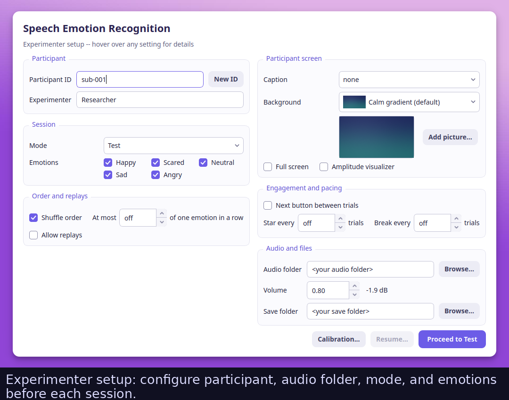
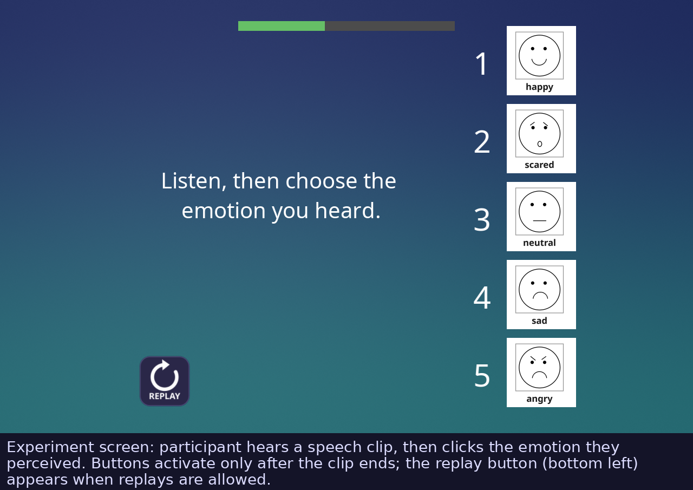
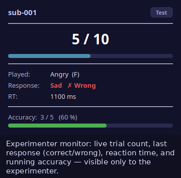
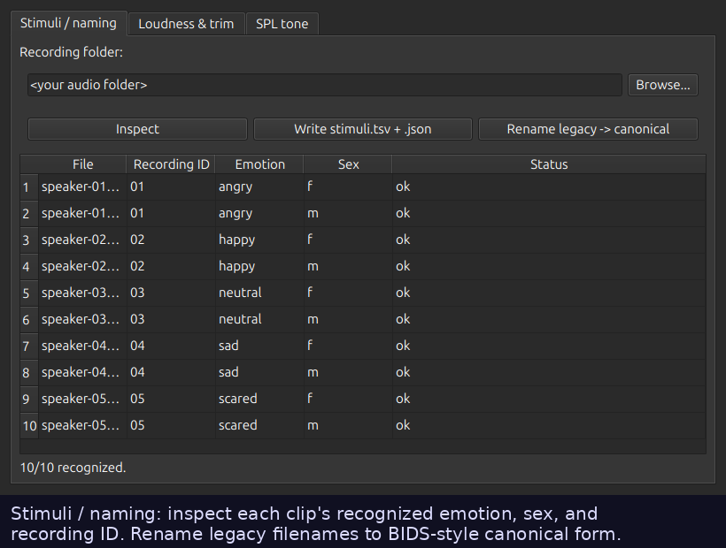
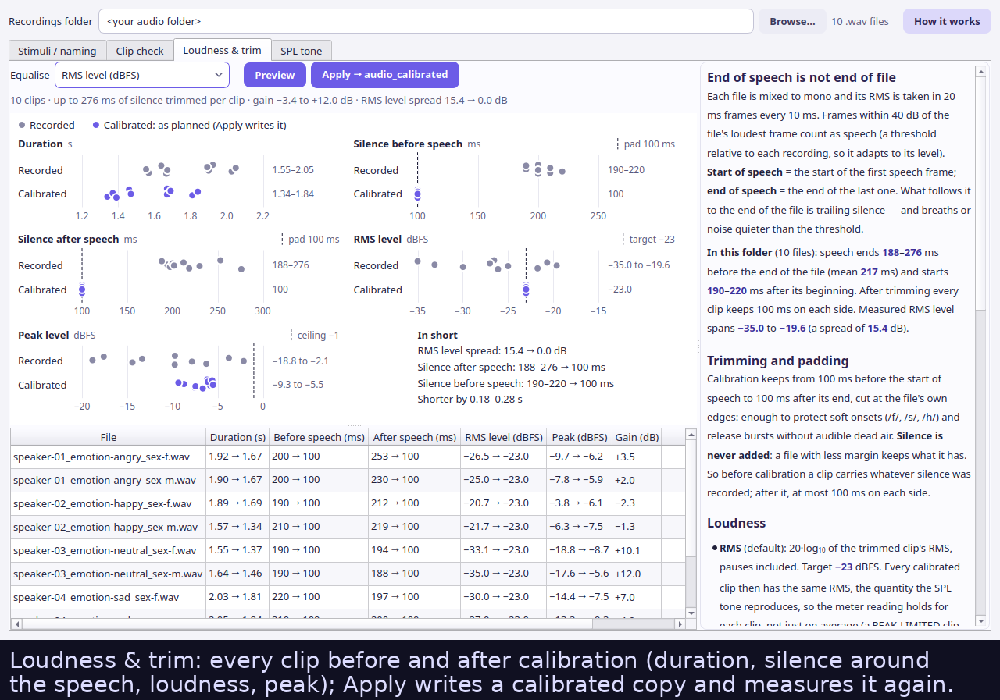
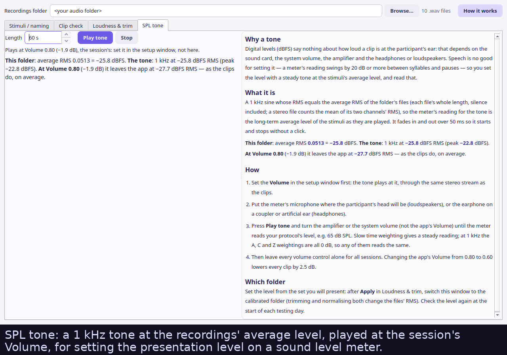

# Emognition 3

**Speech Emotion Recognition** — a behavioral experiment in which a participant
hears a short speech clip and identifies the conveyed emotion (happy, scared,
neutral, sad, or angry). Responses and millisecond-accurate reaction times are
recorded and exported as Excel, PDF, HTML, and CSV reports.

A Python / PsychoPy rewrite of the original MATLAB *Emognition 2* (Auditory
Prostheses & Perception Lab, Boys Town National Research Hospital, 2014–2020),
with feature parity plus a modern UX and cross-platform support. The software
was built for Dr. Monita Chatterjee's
[APPLab](https://sites.northwestern.edu/monitachatterjee/) (now at Northwestern
University) to support research on emotional prosody in cochlear-implant users.
Original MATLAB sources are preserved under [`matlab/`](matlab/) as reference
and homage.

---

## Screenshots

| Experimenter setup | Experiment screen | Live monitor |
|:---:|:---:|:---:|
|  |  |  |
| Configure participant, audio folder, mode, and emotions before each session. | Participant hears a clip, then clicks the perceived emotion. Buttons activate after the clip ends. | Accuracy and reaction time update trial-by-trial on the experimenter's screen. |

<details>
<summary><strong>Calibration window (3 tabs)</strong></summary>

| Stimuli / naming | Loudness & trim | SPL tone |
|:---:|:---:|:---:|
|  |  |  |

</details>

---

## Features

| Feature | Details |
|---|---|
| **Millisecond-accurate RTs** | PTB-scheduled audio onset; RT measured from both offset (default, matching legacy) and onset |
| **Test mode** | Blind test — no feedback — full confusion-matrix report |
| **Passive training** | Correct label revealed after each clip; participant learns the mapping |
| **Active training** | Participant responds, then correct (green) / wrong (orange) feedback before advancing |
| **Begin screen** | The participant starts the session with a big **Begin** button (or Space/Enter); the report's start time and duration count from that press |
| **Background pictures** | Calm, text-free backgrounds to keep children engaged: a soothing gradient by default, five bundled scenes, your own pictures via **Add picture…**, or a slideshow that changes every N trials |
| **Crash-safe autosave** | Every trial is on disk the moment it ends; an interrupted session resumes at the next trial, in the same order |
| **Calibration** | Per-corpus loudness normalization (LUFS), speech-endpoint trim, BIDS-style renaming |
| **Experimenter monitor** | Live per-trial accuracy and RT on the experimenter's screen while the participant runs |
| **Reports** | Self-contained HTML, PDF (confusion heatmap + RT charts), Excel (4 sheets), CSV |
| **Multi-display** | Experiment auto-routes to the participant's screen; setup stays on the experimenter's |
| **Stimulus flexibility** | Legacy `01_ang_f.wav` and BIDS-style `speaker-01_emotion-angry_sex-f.wav` both accepted |
| **Open source** | AGPL-3.0-or-later; no MATLAB, no proprietary toolboxes |

---

## Installation

**Linux — quick start (pre-built)**

```bash
# Download emognition-linux-x86_64.zip from the Releases page, then:
unzip emognition-linux-x86_64.zip
chmod +x emognition/emognition
./emognition/emognition
```

<details>
<summary><strong>Windows — pre-built (no Python needed)</strong></summary>

**No Python, no installation program — just unzip and run.**

1. Go to the [**Releases page**](https://github.com/mhozan/Emognition/releases)
   and click the latest release (top of the list).

2. Under **Assets**, click **`emognition-windows-x86_64.zip`** to download it.

3. **Extract the zip:**
   - Find the downloaded file (usually in your `Downloads` folder).
   - Right-click it → **Extract All…**
   - Choose where to put it — e.g. your Desktop or Documents folder — then
     click **Extract**.
   - This creates an **`emognition`** folder at that location.

4. **Open the `emognition` folder** (double-click it).
   Inside you will see `emognition.exe` alongside many support files — this is
   normal. The support files must stay in the same folder as the `.exe`.

5. **Double-click `emognition.exe`** to launch the experiment.

> **"Windows protected your PC" warning** — if Windows SmartScreen appears,
> click **More info** then **Run anyway**. This warning appears because the app
> has not been submitted to Microsoft's paid signing programme; the software
> itself is safe and open-source.

> **Black terminal window** — a small black window may appear behind the main
> window when the app starts. This is normal; you can minimise or ignore it.
> It closes automatically when you exit the app.

> **Slow first launch** — the first start can take 10–20 seconds while Windows
> scans the bundle. Subsequent launches are faster.

</details>

**Which Python?** The pre-built downloads above include their own Python. To
run from source you need **Python 3.12**, the newest version PsychoPy supports:
PsychoPy 2026.2 installs on Python 3.10–3.12 only. Python 3.13 and later,
including the current 3.15, can't install PsychoPy yet. Emognition will move to
a newer Python as soon as a PsychoPy release allows it. Any 3.12.x works, so
take the newest one your installer offers.

<details>
<summary><strong>Windows — from source</strong></summary>

You need **Python 3.12** (see *Which Python?* above).
All commands below are for **PowerShell**; do not use Command Prompt.

**Step 1 — Open PowerShell**

- **Windows 11:** press `Win + X` → click **Terminal**.
- **Windows 10:** press `Win`, type `PowerShell`, right-click → **Run as administrator**.

> **"Running scripts is disabled"?** Run this once in an administrator PowerShell, then reopen:
> ```powershell
> Set-ExecutionPolicy -ExecutionPolicy RemoteSigned -Scope CurrentUser
> ```

**Step 2 — Install Python 3.12**

Download **Windows installer (64-bit)** from
[python.org/downloads/release/python-31210](https://www.python.org/downloads/release/python-31210/)
(`python-3.12.10-amd64.exe`). 3.12.10 is the newest 3.12 release that has an
installer; later 3.12 releases are security fixes published as source code only.
On the first screen, tick **"Add python.exe to PATH"**, then click **Install Now**.

Check it: `py -3.12 --version` should print `Python 3.12.10`.

**Step 3 — Install Git**

Download from [git-scm.com/download/win](https://git-scm.com/download/win), run with default options, then reopen PowerShell.

**Step 4 — Download and set up**

```powershell
cd "$HOME\Documents"
git clone https://github.com/mhozan/Emognition.git
cd Emognition
py -3.12 -m venv .venv
.venv\Scripts\Activate.ps1
pip install --no-deps -r requirements.txt
python -m emognition
```

> **Next time:** open PowerShell in the `Emognition` folder, then:
> ```powershell
> .venv\Scripts\Activate.ps1
> python -m emognition
> ```

</details>

<details>
<summary><strong>macOS — from source</strong></summary>

**Step 1 — Install Python 3.12**

Option A (Homebrew, which keeps 3.12 at its newest patch release):
```bash
brew install python@3.12
```

Option B: download the **macOS 64-bit universal2 installer** from
[python.org/downloads/release/python-31210](https://www.python.org/downloads/release/python-31210/)
and run it. 3.12.10 is the newest 3.12 release with an installer.

**Step 2 — Install PortAudio** (required for PsychoPy audio)

```bash
brew install portaudio
```

No Homebrew? Install it first: [brew.sh](https://brew.sh).

**Step 3 — Download and set up**

```bash
git clone https://github.com/mhozan/Emognition.git
cd Emognition
python3.12 -m venv .venv
source .venv/bin/activate
pip install --no-deps -r requirements.txt
python -m emognition
```

> Run `source .venv/bin/activate` at the start of each new terminal session.

</details>

<details>
<summary><strong>Linux — from source</strong></summary>

**Step 1 — Install Python 3.12 and the system libraries**

```bash
sudo apt-get update
sudo apt-get install -y \
  python3.12 python3.12-venv python3.12-dev \
  libglu1-mesa libgl1 libegl1 libsndfile1 libportaudio2 \
  libxcb-cursor0 libxcb-xinerama0 libxkbcommon-x11-0 libdbus-1-3 \
  git
```

> Ubuntu 24.04 ships Python 3.12. On other releases, add the deadsnakes PPA
> first (`sudo add-apt-repository ppa:deadsnakes/ppa && sudo apt-get update`),
> or install 3.12 with pyenv (`pyenv install 3.12` picks the newest 3.12.x).

**Step 2 — Download and set up**

```bash
git clone https://github.com/mhozan/Emognition.git
cd Emognition
python3.12 -m venv .venv
source .venv/bin/activate
pip install --no-deps -r requirements.txt
python -m emognition
```

</details>

---

## Using the app

### 1. Setup window

Fill in the participant ID, select your audio folder, and choose a session mode:

| Mode | What it does |
|---|---|
| **Test** | Blind test — no feedback |
| **Passive Training** | Correct answer shown after each clip |
| **Active Training** | Participant responds, then correct/wrong feedback |

Click **Calibration** before your first run with a new stimulus corpus to
normalize loudness and inspect file naming.

**Background** sets what the participant sees behind the buttons:

- **Calm gradient (default)**: a soothing indigo-to-teal blend, drawn at the
  screen's exact resolution.
- **A bundled scene**: Starry night, Under the sea, Rolling hills, Soft bubbles,
  or Classic purple (the original Emognition background). All are calm, contain
  no text or faces, and are dark enough for the white prompt to stay readable.
- **Your own picture**: click **Add picture…**. The picture is copied into
  `~/.emognition/backgrounds/`, turned upright, resized, and stripped of all
  metadata, including phone GPS. Delete files from that folder to remove them.
  Bright photos are dimmed slightly, and the on-screen text gets a translucent
  panel behind it.
- **Slideshow (all pictures)**: the bundled and added pictures take turns,
  changing every *N* trials (1–20) and optionally shuffled, as in the original.
  Pictures only change *between* trials and are decoded ahead of time, so they
  never touch audio timing or reaction times.
- **None (plain)**: the classic plain grey screen.

When the session starts, the participant window shows the background and a
large **Begin** button. The session, and its recorded start time, begins when
the participant clicks it, or when the experimenter presses Space or Enter.

### 2. Stimulus corpus

The app accepts two naming conventions:

**Legacy** (Emognition 2):
```
01_ang_f.wav   02_hap_m.wav   03_neu_f.wav ...
 ^  ^   ^
 ID emo sex   (ang/hap/sad/neu/sca  ×  f/m)
```

**BIDS-style canonical** (produced by the Calibration → Rename step):
```
speaker-01_emotion-angry_sex-f.wav
speaker-01_emotion-angry_sex-m.wav
speaker-02_emotion-happy_sex-f.wav  ...
```

Use **Calibration → Stimuli / Naming** to inspect what the app has parsed from
your folder and confirm each file's detected emotion and sex before running.

### 3. Reports

After each session these files are written to your chosen save folder. The raw
CSV goes first, so the data is safe even if a later format fails:

- `ParticipantID_YYYYMMDD_HHMMSS.csv` — per-trial raw data, plus `_summary.csv`
- `.json` — how the session was run: every setting, the **random seed** and the
  resulting trial order, the background plan, timing quality (refresh rate,
  dropped frames, predicted audio latency) and software versions. Re-run the
  exact same order with `--seed <seed>`.
- `.html` — self-contained dark-themed report with confusion matrix, RT
  distribution charts (onset + offset), per-trial table
- `.pdf` — same content, portable
- `.xlsx` — four sheets: Session Info, Confusion Matrix (heat-mapped), Percentages
  (by sex), Pressed Keys (with RT + quality flags + recording ID)

Every format shows the same session details, including the seed, the refresh
rate and the share of dropped frames (reaction times are sampled once per
frame, so these say how precise the RTs were). Alongside % correct, the reports
give **Wagner's unbiased hit rate (Hu)** per emotion and **Cohen's κ** overall.
Raw % correct gives a participant who answers "Neutral" every time 100% on
Neutral; Hu and κ don't. They also give the RT median, SD and IQR, and the
confusion matrix as counts and as % of each row (Excel sheet *Confusion (% of
row)*, and `_confusion.csv` in long format for R/pandas). The per-trial CSV
records which background picture was on screen.

**If a session is interrupted** (a crash, a power cut, the window closed), its
trials are not lost: each one is written to
`ParticipantID_YYYYMMDD_HHMMSS.partial.jsonl` the moment it ends. The next time
you click Proceed with the same participant ID and save folder, the setup
window offers to **Resume**. The session then carries on at the next trial with
the same settings and trial order, and its reports cover all of it. From the
command line, use `--resume <that file>`. The `.partial.jsonl` file is deleted
once the reports are written. A session stopped with Esc writes reports for the
trials so far and keeps the file, so it can still be finished later.

<details>
<summary><strong>Reaction-time definition</strong></summary>

Reaction times are measured **two ways**, matching the original tool:

- **From audio offset** *(default, matches legacy `reactiontime.m`)* — time from
  when the clip *ends* to the response. Positive = answered after the clip.
- **From audio onset** — time from when the clip *starts*. Both are included in
  the Excel and HTML reports.

The RT quality flags `anticipatory` (< 150 ms from onset; since answers unlock
only when the clip ends, this can only happen with clips shorter than that) and
`slow outlier` (above median + 3 × 1.4826 × MAD, the robust SD, floored at 50 ms)
are marked in the reports and excluded from the reaction-time means. Accuracy
and the confusion matrix always use every answered trial.

</details>

---

## Development

```bash
pytest                           # the whole suite; no display or audio needed
pytest -v tests/test_timing.py   # just the timing tests
```

### Project layout

```
emognition/
  core/        UI-free logic: emotions, stimuli, timing, scoring, session modes
  audio/       Loudness normalization (LUFS), speech endpoint detection/trim
  naming/      BIDS-style canonical names + legacy parser + TSV manifest
  ui/          PyQt6 setup/calibration/monitor windows; PsychoPy experiment window
  reports/     HTML, PDF, Excel, CSV writers
  io/          Cross-platform file-open helper
assets/
  audio/       10 reference clips (5 emotions × 2 sexes), BIDS-named
  images/      Emoticon buttons, backgrounds, icon
matlab/        Original MATLAB sources (reference + homage)
scripts/       Build helpers; timing spike
tests/         pytest suite
```

### Adding a new report format

Implement a `write_XYZ_report(responses, path, *, info)` function in
`emognition/reports/XYZ.py`, import it in `emognition/reports/__init__.py`,
and add it to `_write_reports()` in `emognition/app.py` (each format is written
in isolation, after the raw CSV). Every report test builds a small list of
`Response` objects inline (see `tests/test_csv_report.py`); copy that pattern.
`tests/test_report_info.py` and `tests/test_report_consistency.py` check that
all formats show the same details and numbers.

<details>
<summary><strong>Building a standalone executable</strong></summary>

Requires the pinned build tools (the same PyInstaller CI uses):

```bash
.venv/bin/pip install -r requirements-build.txt
scripts/build_executable.sh       # Linux / macOS
scripts\build_executable.bat      # Windows
```

CI (`.github/workflows/build.yml`) runs the test suite on Linux and Windows for
every push to `master` and every pull request; version tags (`v*`) also build
both bundles, smoke-test them with `--selfcheck`, and publish them with a
`SHA256SUMS.txt`.

Output: `dist/emognition/` (about 0.55 GB unzipped; zip it to distribute).

Verify the bundle without a display:

```bash
./dist/emognition/emognition --selfcheck
```

Per-OS binaries are also built automatically by
[GitHub Actions](.github/workflows/build.yml) on every tagged release.

</details>

<details>
<summary><strong>CLI reference</strong></summary>

```
python -m emognition [OPTIONS]

Options:
  (no args)          Open the experimenter setup window
  --setup            Same as above
  --calibrate        Open the Calibration window
  --selfcheck        Headless import test — use to verify a frozen bundle
  --participant ID   Participant label [Participant01]
  --experimenter ID  Experimenter name [APPstaff]
  --audio-dir PATH   Folder of .wav stimuli (default: bundled reference clips)
  --save-dir PATH    Output folder for reports [save_location/ next to the app,
                     or in the current folder when run from source]
  --mode MODE        test | passive | active  [test]
  --emotions TAGS    Comma-separated subset, e.g. hap,sad,ang  [all five]
  --caption LANG     none | english | mandarin  [none]
  --volume FLOAT     Playback volume 0–1  [0.8]
  --fullscreen       Run the experiment window fullscreen
  --screen INT       Display index for the experiment window [0]
  --no-shuffle       Present clips in folder order instead of shuffled
  --allow-replays    Show a replay button (and 'r' key)
  --amp-visualizer   Show a green amplitude LED during playback
  --background SPEC  default | none | slideshow | picture file | picture folder  [default]
  --background-every N        Slideshow: change picture every N trials (1–20)  [5]
  --[no-]background-shuffle   Slideshow: shuffle the picture order  [on]
  --seed N           Random seed for the trial and picture order  [random; recorded]
  --resume LOG       Continue an interrupted session from its .partial.jsonl file
                     (its settings and trial order; only the display is new)
  --no-begin         Start straight away, without the Begin screen (automation)
  --version          Print version and exit
```

</details>

---

## Citation

If you use Emognition in a publication, please cite the software:

```
Hozan, M. (2026). Emognition 3: A cross-platform Speech Emotion Recognition
experiment (PsychoPy). GitHub. https://github.com/mhozan/Emognition
```

> A methods paper describing the updated platform is in preparation.

Representative peer-reviewed studies produced with Emognition:

> Chatterjee, M., Kulkarni, A. M., Siddiqui, R. M., Christensen, J. A.,
> Hozan, M., Sis, J. L., & Damm, S. A. (2019). Acoustics of emotional prosody
> produced by prelingually deaf children with cochlear implants.
> *Frontiers in Psychology*, 10, 2190.
> [doi:10.3389/fpsyg.2019.02190](https://doi.org/10.3389/fpsyg.2019.02190)

> Cannon, S. A., & Chatterjee, M. (2019). Voice emotion recognition by children
> with mild-to-moderate hearing loss.
> *Ear and Hearing*, 40(3), 477–492.
> [doi:10.1097/AUD.0000000000000637](https://doi.org/10.1097/AUD.0000000000000637)

> Christensen, J. A., Sis, J., Kulkarni, A. M., & Chatterjee, M. (2019).
> Effects of age and hearing loss on the recognition of emotions in speech.
> *Ear and Hearing*, 40(5), 1069–1083.
> [doi:10.1097/AUD.0000000000000694](https://doi.org/10.1097/AUD.0000000000000694)

> Chatterjee, M., Gajre, S., Kulkarni, A. M., Barrett, K. C., & Limb, C. J. (2024).
> Predictors of emotional prosody identification by school-age children with
> cochlear implants and their peers with normal hearing.
> *Ear and Hearing*, 45(2), 411–424.
> [doi:10.1097/AUD.0000000000001436](https://doi.org/10.1097/AUD.0000000000001436)

---

## License

[GNU AGPL-3.0-or-later](LICENSE). Copyleft; compatible with PsychoPy (GPLv3+).
Derivatives — **including modified versions offered over a network** — must remain
open under the same license.

For commercial / proprietary licensing inquiries regarding the original author's
own contributions, contact the author directly.

---

## Acknowledgements

Emognition 3 builds on the shoulders of:

- **PsychoPy** (Peirce et al.) — experiment engine and PTB audio backend
- **PyQt6** — experimenter UI
- **pyloudnorm** — ITU-R BS.1770 loudness normalization
- **openpyxl**, **fpdf2**, **matplotlib** — report generation
- **soundfile / libsndfile** — audio I/O
- The original **Emognition 2** design and MATLAB implementation (Auditory
  Prostheses & Perception Lab, Boys Town National Research Hospital, 2014–2020)
- **Dr. Monita Chatterjee** and the
  [APPLab](https://sites.northwestern.edu/monitachatterjee/) (now at
  Northwestern University, Dept. of Communication Sciences and Disorders),
  whose research program on emotional prosody in cochlear-implant users this
  software was built for
